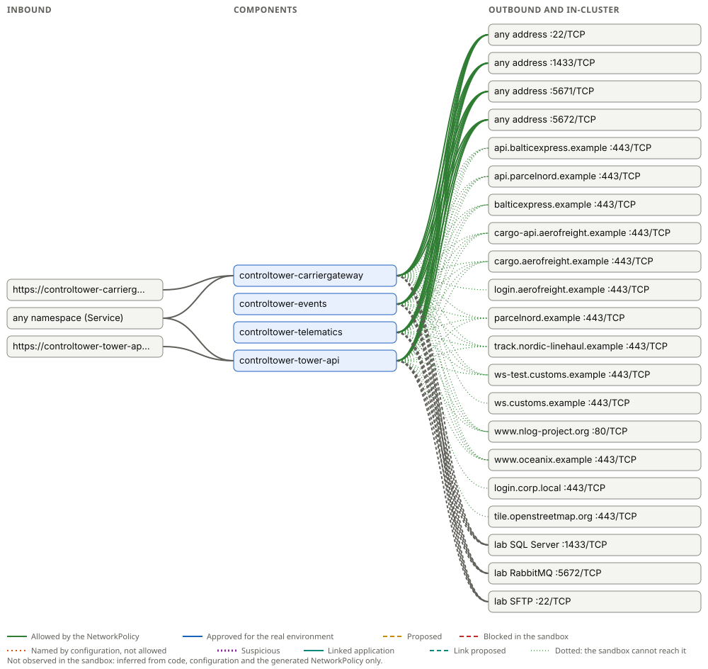

# Network connectivity: containerization-challenge-control-tower

Generated by Containerizer at 2026-11-05T15:30:02Z. The machine-readable form is [connectivity.yaml](connectivity.yaml); the platform or firewall team can write the real environment's rules from it.

> Approved destinations are documented for the real environment: use them (FQDN, port, protocol) for its firewall rules. Approval opens nothing in the sandbox: it stays isolated, its NetworkPolicies allow only what was inferred and confirmed links between applications, and on the appliance only the administrators' egress rules let anything out.

Not observed in the sandbox yet: everything below is inferred from the code, the configuration and the generated NetworkPolicy.

## Inbound

| Component | From | Port |
| --- | --- | --- |
| controltower-carriergateway | https://controltower-carriergateway-containerization-challenge-512c0b90.sandbox.lab/ | 80/TCP → 8080 |
| controltower-carriergateway | any namespace (Service) | 80/TCP → 8080 |
| controltower-tower-api | https://controltower-tower-api-containerization-challenge-control-tower.sandbox.lab/ | 80/TCP → 8080 |
| controltower-tower-api | any namespace (Service) | 80/TCP → 8080 |

## Between components and lab services

| From | To | Port | Source |
| --- | --- | --- | --- |
| controltower-carriergateway | lab SQL Server | 1433/TCP | lab service |
| controltower-carriergateway | lab RabbitMQ | 5672/TCP | lab service |
| controltower-carriergateway | lab SFTP | 22/TCP | lab service |
| controltower-events | lab SQL Server | 1433/TCP | lab service |
| controltower-events | lab RabbitMQ | 5672/TCP | lab service |
| controltower-events | lab SFTP | 22/TCP | lab service |
| controltower-telematics | lab SQL Server | 1433/TCP | lab service |
| controltower-telematics | lab RabbitMQ | 5672/TCP | lab service |
| controltower-telematics | lab SFTP | 22/TCP | lab service |
| controltower-tower-api | lab SQL Server | 1433/TCP | lab service |
| controltower-tower-api | lab RabbitMQ | 5672/TCP | lab service |
| controltower-tower-api | lab SFTP | 22/TCP | lab service |

## Outbound

| Component | Destination | Port | Status | Sources | Reason | Evidence | Observed | Approved | Sandbox |
| --- | --- | --- | --- | --- | --- | --- | --- | --- | --- |
| controltower-carriergateway | any address | 22/TCP | Allowed | NetworkPolicy | the NetworkPolicy opens port 22 for sftp (inferred from packages or code) |  |  |  | unknown: only the destinations the appliance's egress rules allow |
| controltower-carriergateway | any address | 1433/TCP | Allowed | NetworkPolicy | the NetworkPolicy opens port 1433 for sql-server (inferred from packages or code) |  |  |  | unknown: only the destinations the appliance's egress rules allow |
| controltower-carriergateway | any address | 5671/TCP | Allowed | NetworkPolicy | the NetworkPolicy opens port 5671 for rabbitmq (inferred from packages or code) |  |  |  | unknown: only the destinations the appliance's egress rules allow |
| controltower-carriergateway | any address | 5672/TCP | Allowed | NetworkPolicy | the NetworkPolicy opens port 5672 for rabbitmq (inferred from packages or code) |  |  |  | unknown: only the destinations the appliance's egress rules allow |
| controltower-carriergateway | api.balticexpress.example | 443/TCP | Allowed | code | http-apis | `src/ControlTower.Data/Seed/ReferenceData.cs:67` |  |  | not reachable: refused by the appliance's DNS filter: no egress rule allows it |
| controltower-carriergateway | api.parcelnord.example | 443/TCP | Allowed | code | http-apis | `src/ControlTower.Data/Seed/ReferenceData.cs:73` |  |  | not reachable: refused by the appliance's DNS filter: no egress rule allows it |
| controltower-carriergateway | balticexpress.example | 443/TCP | Allowed | code | http-apis | `src/ControlTower.Data/Seed/ReferenceData.cs:67` |  |  | not reachable: refused by the appliance's DNS filter: no egress rule allows it |
| controltower-carriergateway | cargo-api.aerofreight.example | 443/TCP | Allowed | code | http-apis | `src/ControlTower.Data/Seed/ReferenceData.cs:72` |  |  | not reachable: refused by the appliance's DNS filter: no egress rule allows it |
| controltower-carriergateway | cargo.aerofreight.example | 443/TCP | Allowed | code | http-apis | `src/ControlTower.Data/Seed/ReferenceData.cs:72` |  |  | not reachable: refused by the appliance's DNS filter: no egress rule allows it |
| controltower-carriergateway | login.aerofreight.example | 443/TCP | Allowed | configuration | http-apis | `src/ControlTower.CarrierGateway/appsettings.json:72` |  |  | not reachable: refused by the appliance's DNS filter: no egress rule allows it |
| controltower-carriergateway | parcelnord.example | 443/TCP | Allowed | code | http-apis | `src/ControlTower.Data/Seed/ReferenceData.cs:73` |  |  | not reachable: refused by the appliance's DNS filter: no egress rule allows it |
| controltower-carriergateway | track.nordic-linehaul.example | 443/TCP | Allowed | code | http-apis | `src/ControlTower.Data/Seed/ReferenceData.cs:66` |  |  | not reachable: refused by the appliance's DNS filter: no egress rule allows it |
| controltower-carriergateway | ws-test.customs.example | 443/TCP | Allowed | code | http-apis | `src/ControlTower.Integration/Customs/CustomsOptions.cs:9` |  |  | not reachable: refused by the appliance's DNS filter: no egress rule allows it |
| controltower-carriergateway | ws.customs.example | 443/TCP | Allowed | configuration | http-apis | `src/ControlTower.CarrierGateway/appsettings.json:81` |  |  | not reachable: refused by the appliance's DNS filter: no egress rule allows it |
| controltower-carriergateway | www.nlog-project.org | 80/TCP | Allowed | configuration | http-apis | `src/ControlTower.CarrierGateway/nlog.config:2` |  |  | not reachable: refused by the appliance's DNS filter: no egress rule allows it |
| controltower-carriergateway | www.oceanix.example | 443/TCP | Allowed | code | http-apis | `src/ControlTower.Data/Seed/ReferenceData.cs:70` |  |  | not reachable: refused by the appliance's DNS filter: no egress rule allows it |
| controltower-events | any address | 22/TCP | Allowed | NetworkPolicy | the NetworkPolicy opens port 22 for sftp (inferred from packages or code) |  |  |  | unknown: only the destinations the appliance's egress rules allow |
| controltower-events | any address | 1433/TCP | Allowed | NetworkPolicy | the NetworkPolicy opens port 1433 for sql-server (inferred from packages or code) |  |  |  | unknown: only the destinations the appliance's egress rules allow |
| controltower-events | any address | 5671/TCP | Allowed | NetworkPolicy | the NetworkPolicy opens port 5671 for rabbitmq (inferred from packages or code) |  |  |  | unknown: only the destinations the appliance's egress rules allow |
| controltower-events | any address | 5672/TCP | Allowed | NetworkPolicy | the NetworkPolicy opens port 5672 for rabbitmq (inferred from packages or code) |  |  |  | unknown: only the destinations the appliance's egress rules allow |
| controltower-events | api.balticexpress.example | 443/TCP | Allowed | code | http-apis | `src/ControlTower.Data/Seed/ReferenceData.cs:67` |  |  | not reachable: refused by the appliance's DNS filter: no egress rule allows it |
| controltower-events | api.parcelnord.example | 443/TCP | Allowed | code | http-apis | `src/ControlTower.Data/Seed/ReferenceData.cs:73` |  |  | not reachable: refused by the appliance's DNS filter: no egress rule allows it |
| controltower-events | balticexpress.example | 443/TCP | Allowed | code | http-apis | `src/ControlTower.Data/Seed/ReferenceData.cs:67` |  |  | not reachable: refused by the appliance's DNS filter: no egress rule allows it |
| controltower-events | cargo-api.aerofreight.example | 443/TCP | Allowed | code | http-apis | `src/ControlTower.Data/Seed/ReferenceData.cs:72` |  |  | not reachable: refused by the appliance's DNS filter: no egress rule allows it |
| controltower-events | cargo.aerofreight.example | 443/TCP | Allowed | code | http-apis | `src/ControlTower.Data/Seed/ReferenceData.cs:72` |  |  | not reachable: refused by the appliance's DNS filter: no egress rule allows it |
| controltower-events | parcelnord.example | 443/TCP | Allowed | code | http-apis | `src/ControlTower.Data/Seed/ReferenceData.cs:73` |  |  | not reachable: refused by the appliance's DNS filter: no egress rule allows it |
| controltower-events | track.nordic-linehaul.example | 443/TCP | Allowed | code | http-apis | `src/ControlTower.Data/Seed/ReferenceData.cs:66` |  |  | not reachable: refused by the appliance's DNS filter: no egress rule allows it |
| controltower-events | ws-test.customs.example | 443/TCP | Allowed | code | http-apis | `src/ControlTower.Integration/Customs/CustomsOptions.cs:9` |  |  | not reachable: refused by the appliance's DNS filter: no egress rule allows it |
| controltower-events | www.nlog-project.org | 80/TCP | Allowed | configuration | http-apis | `src/ControlTower.Events/nlog.config:2` |  |  | not reachable: refused by the appliance's DNS filter: no egress rule allows it |
| controltower-events | www.oceanix.example | 443/TCP | Allowed | code | http-apis | `src/ControlTower.Data/Seed/ReferenceData.cs:70` |  |  | not reachable: refused by the appliance's DNS filter: no egress rule allows it |
| controltower-telematics | any address | 22/TCP | Allowed | NetworkPolicy | the NetworkPolicy opens port 22 for sftp (inferred from packages or code) |  |  |  | unknown: only the destinations the appliance's egress rules allow |
| controltower-telematics | any address | 1433/TCP | Allowed | NetworkPolicy | the NetworkPolicy opens port 1433 for sql-server (inferred from packages or code) |  |  |  | unknown: only the destinations the appliance's egress rules allow |
| controltower-telematics | any address | 5671/TCP | Allowed | NetworkPolicy | the NetworkPolicy opens port 5671 for rabbitmq (inferred from packages or code) |  |  |  | unknown: only the destinations the appliance's egress rules allow |
| controltower-telematics | any address | 5672/TCP | Allowed | NetworkPolicy | the NetworkPolicy opens port 5672 for rabbitmq (inferred from packages or code) |  |  |  | unknown: only the destinations the appliance's egress rules allow |
| controltower-telematics | api.balticexpress.example | 443/TCP | Allowed | code | http-apis | `src/ControlTower.Data/Seed/ReferenceData.cs:67` |  |  | not reachable: refused by the appliance's DNS filter: no egress rule allows it |
| controltower-telematics | api.parcelnord.example | 443/TCP | Allowed | code | http-apis | `src/ControlTower.Data/Seed/ReferenceData.cs:73` |  |  | not reachable: refused by the appliance's DNS filter: no egress rule allows it |
| controltower-telematics | balticexpress.example | 443/TCP | Allowed | code | http-apis | `src/ControlTower.Data/Seed/ReferenceData.cs:67` |  |  | not reachable: refused by the appliance's DNS filter: no egress rule allows it |
| controltower-telematics | cargo-api.aerofreight.example | 443/TCP | Allowed | code | http-apis | `src/ControlTower.Data/Seed/ReferenceData.cs:72` |  |  | not reachable: refused by the appliance's DNS filter: no egress rule allows it |
| controltower-telematics | cargo.aerofreight.example | 443/TCP | Allowed | code | http-apis | `src/ControlTower.Data/Seed/ReferenceData.cs:72` |  |  | not reachable: refused by the appliance's DNS filter: no egress rule allows it |
| controltower-telematics | parcelnord.example | 443/TCP | Allowed | code | http-apis | `src/ControlTower.Data/Seed/ReferenceData.cs:73` |  |  | not reachable: refused by the appliance's DNS filter: no egress rule allows it |
| controltower-telematics | track.nordic-linehaul.example | 443/TCP | Allowed | code | http-apis | `src/ControlTower.Data/Seed/ReferenceData.cs:66` |  |  | not reachable: refused by the appliance's DNS filter: no egress rule allows it |
| controltower-telematics | ws-test.customs.example | 443/TCP | Allowed | code | http-apis | `src/ControlTower.Integration/Customs/CustomsOptions.cs:9` |  |  | not reachable: refused by the appliance's DNS filter: no egress rule allows it |
| controltower-telematics | www.nlog-project.org | 80/TCP | Allowed | configuration | http-apis | `src/ControlTower.Telematics/nlog.config:2` |  |  | not reachable: refused by the appliance's DNS filter: no egress rule allows it |
| controltower-telematics | www.oceanix.example | 443/TCP | Allowed | code | http-apis | `src/ControlTower.Data/Seed/ReferenceData.cs:70` |  |  | not reachable: refused by the appliance's DNS filter: no egress rule allows it |
| controltower-tower-api | any address | 22/TCP | Allowed | NetworkPolicy | the NetworkPolicy opens port 22 for sftp (inferred from packages or code) |  |  |  | unknown: only the destinations the appliance's egress rules allow |
| controltower-tower-api | any address | 1433/TCP | Allowed | NetworkPolicy | the NetworkPolicy opens port 1433 for sql-server (inferred from packages or code) |  |  |  | unknown: only the destinations the appliance's egress rules allow |
| controltower-tower-api | any address | 5671/TCP | Allowed | NetworkPolicy | the NetworkPolicy opens port 5671 for rabbitmq (inferred from packages or code) |  |  |  | unknown: only the destinations the appliance's egress rules allow |
| controltower-tower-api | any address | 5672/TCP | Allowed | NetworkPolicy | the NetworkPolicy opens port 5672 for rabbitmq (inferred from packages or code) |  |  |  | unknown: only the destinations the appliance's egress rules allow |
| controltower-tower-api | api.balticexpress.example | 443/TCP | Allowed | code | http-apis | `src/ControlTower.Data/Seed/ReferenceData.cs:67` |  |  | not reachable: refused by the appliance's DNS filter: no egress rule allows it |
| controltower-tower-api | api.parcelnord.example | 443/TCP | Allowed | code | http-apis | `src/ControlTower.Data/Seed/ReferenceData.cs:73` |  |  | not reachable: refused by the appliance's DNS filter: no egress rule allows it |
| controltower-tower-api | balticexpress.example | 443/TCP | Allowed | code | http-apis | `src/ControlTower.Data/Seed/ReferenceData.cs:67` |  |  | not reachable: refused by the appliance's DNS filter: no egress rule allows it |
| controltower-tower-api | cargo-api.aerofreight.example | 443/TCP | Allowed | code | http-apis | `src/ControlTower.Data/Seed/ReferenceData.cs:72` |  |  | not reachable: refused by the appliance's DNS filter: no egress rule allows it |
| controltower-tower-api | cargo.aerofreight.example | 443/TCP | Allowed | code | http-apis | `src/ControlTower.Data/Seed/ReferenceData.cs:72` |  |  | not reachable: refused by the appliance's DNS filter: no egress rule allows it |
| controltower-tower-api | login.corp.local | 443/TCP | Allowed | configuration | http-apis | `src/ControlTower.Tower.Api/appsettings.json:14` |  |  | not reachable: refused by the appliance's DNS filter: no egress rule allows it |
| controltower-tower-api | parcelnord.example | 443/TCP | Allowed | code | http-apis | `src/ControlTower.Data/Seed/ReferenceData.cs:73` |  |  | not reachable: refused by the appliance's DNS filter: no egress rule allows it |
| controltower-tower-api | tile.openstreetmap.org | 443/TCP | Allowed | configuration | http-apis | `src/ControlTower.Tower.Api/appsettings.json:21` |  |  | not reachable: refused by the appliance's DNS filter: no egress rule allows it |
| controltower-tower-api | track.nordic-linehaul.example | 443/TCP | Allowed | code | http-apis | `src/ControlTower.Data/Seed/ReferenceData.cs:66` |  |  | not reachable: refused by the appliance's DNS filter: no egress rule allows it |
| controltower-tower-api | ws-test.customs.example | 443/TCP | Allowed | code | http-apis | `src/ControlTower.Integration/Customs/CustomsOptions.cs:9` |  |  | not reachable: refused by the appliance's DNS filter: no egress rule allows it |
| controltower-tower-api | www.nlog-project.org | 80/TCP | Allowed | configuration | http-apis | `src/ControlTower.Tower.Api/nlog.config:2` |  |  | not reachable: refused by the appliance's DNS filter: no egress rule allows it |
| controltower-tower-api | www.oceanix.example | 443/TCP | Allowed | code | http-apis | `src/ControlTower.Data/Seed/ReferenceData.cs:70` |  |  | not reachable: refused by the appliance's DNS filter: no egress rule allows it |

## Findings

- **unexplained**: controltower-carriergateway: port 1433 is open to any address for sql-server, but no configuration names a destination on it: keep it only if the application needs it, and name the destination for the production firewall
- **unexplained**: controltower-carriergateway: port 5671, 5672 is open to any address for rabbitmq, but no configuration names a destination on it: keep it only if the application needs it, and name the destination for the production firewall
- **unexplained**: controltower-carriergateway: port 22 is open to any address for sftp, but no configuration names a destination on it: keep it only if the application needs it, and name the destination for the production firewall
- **unexplained**: controltower-events: port 1433 is open to any address for sql-server, but no configuration names a destination on it: keep it only if the application needs it, and name the destination for the production firewall
- **unexplained**: controltower-events: port 5671, 5672 is open to any address for rabbitmq, but no configuration names a destination on it: keep it only if the application needs it, and name the destination for the production firewall
- **unexplained**: controltower-events: port 22 is open to any address for sftp, but no configuration names a destination on it: keep it only if the application needs it, and name the destination for the production firewall
- **unexplained**: controltower-telematics: port 1433 is open to any address for sql-server, but no configuration names a destination on it: keep it only if the application needs it, and name the destination for the production firewall
- **unexplained**: controltower-telematics: port 5671, 5672 is open to any address for rabbitmq, but no configuration names a destination on it: keep it only if the application needs it, and name the destination for the production firewall
- **unexplained**: controltower-telematics: port 22 is open to any address for sftp, but no configuration names a destination on it: keep it only if the application needs it, and name the destination for the production firewall
- **unexplained**: controltower-tower-api: port 1433 is open to any address for sql-server, but no configuration names a destination on it: keep it only if the application needs it, and name the destination for the production firewall
- **unexplained**: controltower-tower-api: port 5671, 5672 is open to any address for rabbitmq, but no configuration names a destination on it: keep it only if the application needs it, and name the destination for the production firewall
- **unexplained**: controltower-tower-api: port 22 is open to any address for sftp, but no configuration names a destination on it: keep it only if the application needs it, and name the destination for the production firewall
