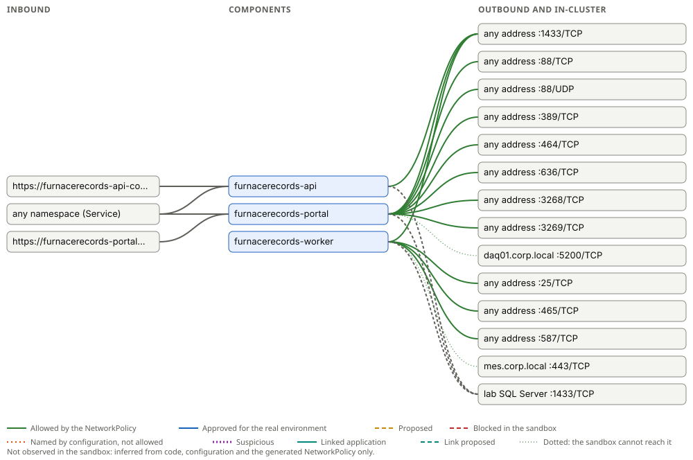

# Network connectivity: containerization-challenge-furnace-records

Generated by Containerizer at 2026-11-04T17:08:25Z. The machine-readable form is [connectivity.yaml](connectivity.yaml); the platform or firewall team can write the real environment's rules from it.

> Approved destinations are documented for the real environment: use them (FQDN, port, protocol) for its firewall rules. Approval opens nothing in the sandbox: it stays isolated, its NetworkPolicies allow only what was inferred and confirmed links between applications, and on the appliance only the administrators' egress rules let anything out.

Not observed in the sandbox yet: everything below is inferred from the code, the configuration and the generated NetworkPolicy.

## Inbound

| Component | From | Port |
| --- | --- | --- |
| furnacerecords-api | https://furnacerecords-api-containerization-challenge-furnace-records.sandbox.lab/ | 80/TCP → 8080 |
| furnacerecords-api | any namespace (Service) | 80/TCP → 8080 |
| furnacerecords-portal | https://furnacerecords-portal-containerization-challenge-furna-15eda163.sandbox.lab/ | 80/TCP → 8080 |
| furnacerecords-portal | any namespace (Service) | 80/TCP → 8080 |

## Between components and lab services

| From | To | Port | Source |
| --- | --- | --- | --- |
| furnacerecords-api | lab SQL Server | 1433/TCP | lab service |
| furnacerecords-portal | lab SQL Server | 1433/TCP | lab service |
| furnacerecords-worker | lab SQL Server | 1433/TCP | lab service |

## Outbound

| Component | Destination | Port | Status | Sources | Reason | Evidence | Observed | Approved | Sandbox |
| --- | --- | --- | --- | --- | --- | --- | --- | --- | --- |
| furnacerecords-api | any address | 1433/TCP | Allowed | NetworkPolicy | the NetworkPolicy opens port 1433 for sql-server (inferred from packages or code) |  |  |  | unknown: only the destinations the appliance's egress rules allow |
| furnacerecords-portal | any address | 88/TCP | Allowed | NetworkPolicy | the NetworkPolicy opens port 88 for active-directory (inferred from packages or code) |  |  |  | unknown: only the destinations the appliance's egress rules allow |
| furnacerecords-portal | any address | 88/UDP | Allowed | NetworkPolicy | the NetworkPolicy opens port 88 for active-directory (inferred from packages or code) |  |  |  | unknown: only the destinations the appliance's egress rules allow |
| furnacerecords-portal | any address | 389/TCP | Allowed | NetworkPolicy | the NetworkPolicy opens port 389 for active-directory (inferred from packages or code) |  |  |  | unknown: only the destinations the appliance's egress rules allow |
| furnacerecords-portal | any address | 464/TCP | Allowed | NetworkPolicy | the NetworkPolicy opens port 464 for active-directory (inferred from packages or code) |  |  |  | unknown: only the destinations the appliance's egress rules allow |
| furnacerecords-portal | any address | 636/TCP | Allowed | NetworkPolicy | the NetworkPolicy opens port 636 for active-directory (inferred from packages or code) |  |  |  | unknown: only the destinations the appliance's egress rules allow |
| furnacerecords-portal | any address | 1433/TCP | Allowed | NetworkPolicy | the NetworkPolicy opens port 1433 for sql-server (inferred from packages or code) |  |  |  | unknown: only the destinations the appliance's egress rules allow |
| furnacerecords-portal | any address | 3268/TCP | Allowed | NetworkPolicy | the NetworkPolicy opens port 3268 for active-directory (inferred from packages or code) |  |  |  | unknown: only the destinations the appliance's egress rules allow |
| furnacerecords-portal | any address | 3269/TCP | Allowed | NetworkPolicy | the NetworkPolicy opens port 3269 for active-directory (inferred from packages or code) |  |  |  | unknown: only the destinations the appliance's egress rules allow |
| furnacerecords-portal | daq01.corp.local | 5200/TCP | Allowed | configuration | configured-ports | `src/FurnaceRecords.Portal/appsettings.json:20` |  |  | not reachable: refused by the appliance's DNS filter: no egress rule allows it |
| furnacerecords-worker | any address | 25/TCP | Allowed | NetworkPolicy | the NetworkPolicy opens port 25 for smtp (inferred from packages or code) |  |  |  | unknown: only the destinations the appliance's egress rules allow |
| furnacerecords-worker | any address | 465/TCP | Allowed | NetworkPolicy | the NetworkPolicy opens port 465 for smtp (inferred from packages or code) |  |  |  | unknown: only the destinations the appliance's egress rules allow |
| furnacerecords-worker | any address | 587/TCP | Allowed | NetworkPolicy | the NetworkPolicy opens port 587 for smtp (inferred from packages or code) |  |  |  | unknown: only the destinations the appliance's egress rules allow |
| furnacerecords-worker | any address | 1433/TCP | Allowed | NetworkPolicy | the NetworkPolicy opens port 1433 for sql-server (inferred from packages or code) |  |  |  | unknown: only the destinations the appliance's egress rules allow |
| furnacerecords-worker | mes.corp.local | 443/TCP | Allowed | configuration | http-apis | `src/FurnaceRecords.Worker/appsettings.json:16` |  |  | not reachable: refused by the appliance's DNS filter: no egress rule allows it |

## Findings

- **unexplained**: furnacerecords-api: port 1433 is open to any address for sql-server, but no configuration names a destination on it: keep it only if the application needs it, and name the destination for the production firewall
- **unexplained**: furnacerecords-portal: port 1433 is open to any address for sql-server, but no configuration names a destination on it: keep it only if the application needs it, and name the destination for the production firewall
- **unexplained**: furnacerecords-portal: port 88, 88, 389, 636, 464, 3268, 3269 is open to any address for active-directory, but no configuration names a destination on it: keep it only if the application needs it, and name the destination for the production firewall
- **unexplained**: furnacerecords-worker: port 1433 is open to any address for sql-server, but no configuration names a destination on it: keep it only if the application needs it, and name the destination for the production firewall
- **unexplained**: furnacerecords-worker: port 25, 465, 587 is open to any address for smtp, but no configuration names a destination on it: keep it only if the application needs it, and name the destination for the production firewall
